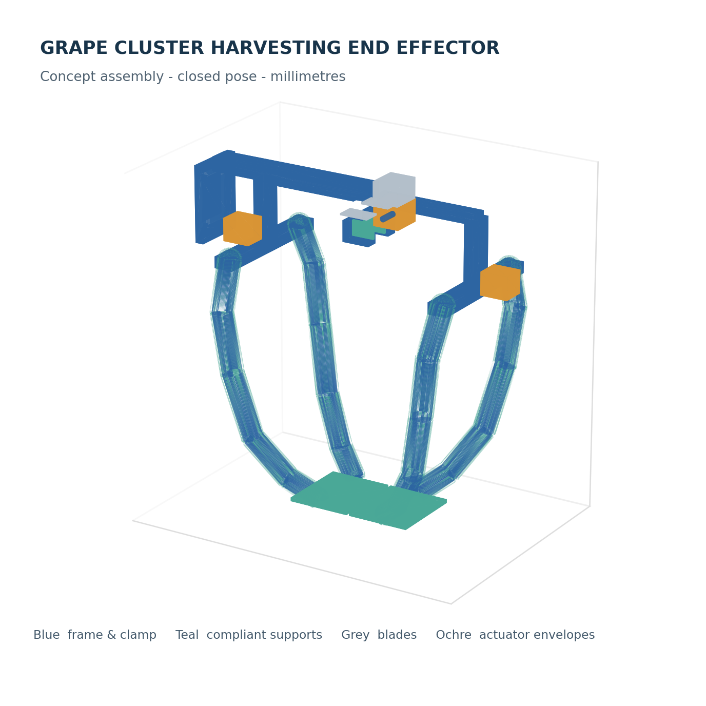
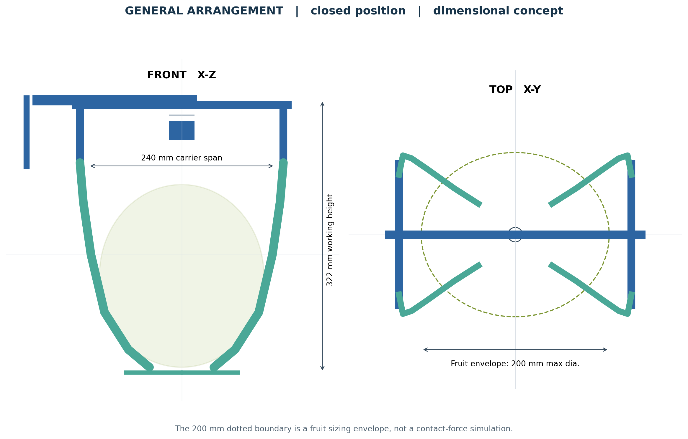

# 葡萄果穗柔性采摘手爪课程设计

中国农业大学《生物生产机器人设计》课程选题 1 的**概念设计**。方案将果串承重、果梗夹持、果梗切断分配给不同部件，并用参数化三维模型表达闭合工位。课程论文和尺寸方案图均可直接查看；源码可用于修改尺寸并重新生成模型。



## 下载与文件目录

| 文件 | 内容 |
| --- | --- |
| [课程设计 PDF](葡萄果穗柔性采摘手爪课程设计.pdf) | 七页中文论文，含背景、设计要求、方案、载荷估算、结论和参考文献 |
| [可编辑 DOCX](葡萄果穗柔性采摘手爪课程设计.docx) | 提交前填写真实姓名、学号和班级 |
| [关键零部件尺寸方案图](关键零部件尺寸方案图.pdf) | 总布置及安装板、果梗钳口、复合指、分体托片的名义尺寸 |
| [STEP 装配](grape_gripper_assembly.step) | 可由 FreeCAD、SolidWorks、Fusion 360 等支持 STEP 的软件导入；单位 mm |
| [STL 整机](grape_gripper_assembly.stl)、[零件 STL](parts/) | 网格预览与分件查看，零件名与建模脚本一致 |
| [完整压缩包](葡萄果穗柔性采摘手爪课程设计全套资料.zip) | 上述交付物和源码的打包副本 |
| [论文原文](paper.md)、[使用说明](使用说明.txt) | 文字内容和提交前检查项 |

## 结构和设计输入

- 果串质量按课程任务给出的 **1.0～1.5 kg**，最大直径按 **150～200 mm**；果梗直径按 **5～15 mm**。
- 两侧四根手指采用较硬骨架和柔性包覆层，底部双片托片承托果串；上部相向钳口先夹果梗，独立刀片随后切断。三维模型中驱动器仅为安装空间包络。
- 按设计假定的竖向搬运加速度 2 m/s²、安全系数 2、最大果串质量 1.5 kg，初步总承载设计值为 **35.43 N**。计算和适用边界见论文第 4 节。
- 整机 STEP 已重新导入核查，装配包络约 **343 × 188 × 333 mm**。模型表示闭合工位，并不包含经验证的开合运动仿真。



## 修改和生成

使用 Python 3.12、CadQuery、Matplotlib、python-docx、Pillow 和 LibreOffice。PDF 导出需要可用的中文字体，例如 Noto Sans CJK SC。所有几何尺寸以毫米为单位。

```bash
python model.py
python figures.py
python parts_drawing.py
python write_report.py
```

`model.py` 生成 STEP、整机 STL、`parts/` 中的分件 STL 及可选的 OpenSCAD 可视化脚本；`figures.py` 和 `parts_drawing.py` 生成论文插图与尺寸方案图；`write_report.py` 根据 `paper.md` 生成 DOCX，并在找到 LibreOffice 时导出 PDF。修改设计参数后，应重新核对论文中的尺寸和计算，不能只更新模型。

## 设计边界

这是课程设计和几何方案，**不是已制造、已田间试验或可直接加工的设备**。钳口开合行程、刀片刃口和传动、铰接及限位、驱动器型号、食品接触材料、实测剪切力与果粒损伤率都需要后续样机试验。课件中的“果梗硬度约 5～10 N”单位是力，不能直接当成材料硬度或 15 mm 果梗剪断力。图纸只标名义尺寸，没有公差与装配工艺。

课程资料与原始文献的出处列在论文末尾。仓库中的三维模型和插图为本课程设计自行绘制。
